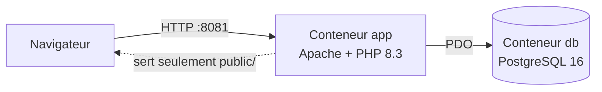
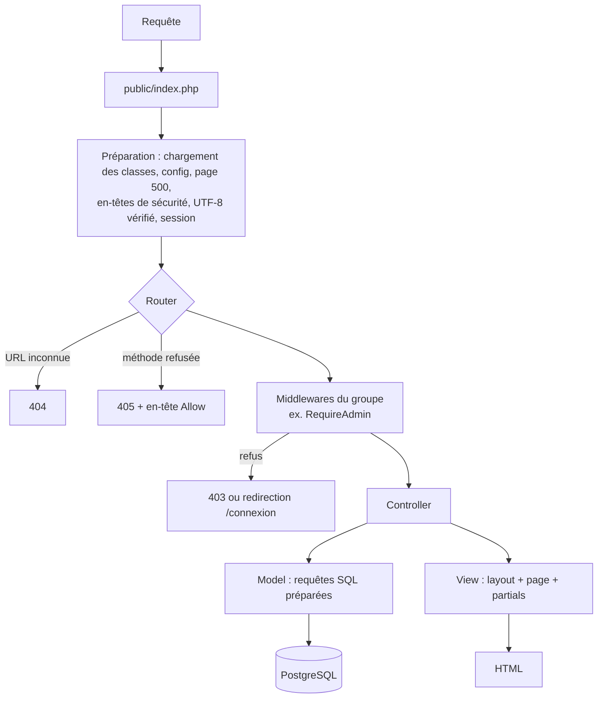
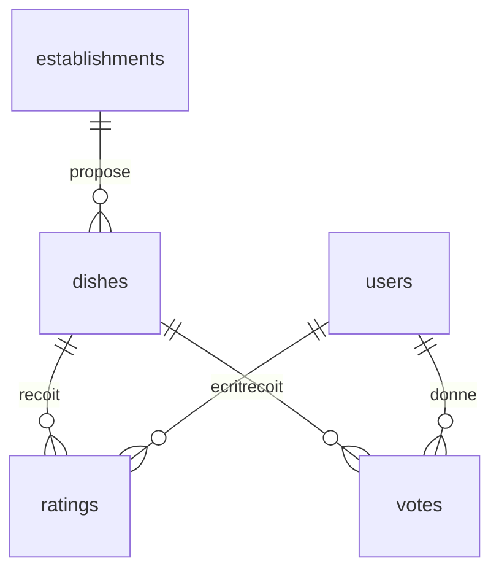
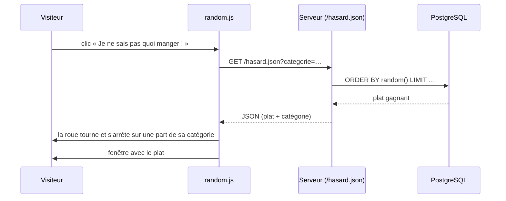

# Architecture de FoodBattle

PHP 8.3 natif (sans framework), PostgreSQL 16, Apache, le tout dans Docker.
Le prototype de départ était une suite de scripts (`index.php`, `plat.php`, `action.php`…) qui mélangeaient
SQL, logique et HTML. Il a été réorganisé en **MVC** (Modèle, Vue, Contrôleur) : chaque fichier a un seul rôle.
Correspondance ancien → nouveau : voir le README.

## 1. Vue d'ensemble

- **Un seul point d'entrée** : Apache ne sert que `public/`. Toutes les URL passent par `public/index.php`
  (fichiers CSS, JS, images exceptés). Le code (`app/`, `config/`) n'est jamais accessible depuis le navigateur.
- **Pas de dépendance externe** (pas de Composer) : rien à installer ni à mettre à jour en dehors de PHP.

## 2. Le trajet d'une requête

Exemple : `POST /plat/5/vote`
1. `index.php` prépare la requête (session, en-têtes).
2. Le `Router` trouve la route, dans le groupe `RequireLogin`.
3. `RequireLogin` vérifie que le compte existe toujours en base ; sinon, redirection vers `/connexion`.
4. `DishController::vote()` vérifie le jeton CSRF et que le plat existe, puis appelle `Vote::create()`.
5. Redirection vers la fiche du plat : `/plat/5?ok=1`, ou `?deja=1` si ce compte a déjà voté
   (la contrainte `UNIQUE` de la base l'empêche de voter deux fois). Après une redirection, recharger la page ne revote pas.

## 3. Organisation des dossiers et règles

| Dossier | Rôle | Règle |
|---|---|---|
| `public/index.php` | Point d'entrée unique | Prépare la requête, puis la confie au routeur |
| `config/routes.php` | Toutes les URL, groupées par middleware | Toute route admin est déclarée **dans** le groupe `RequireAdmin` |
| `app/Core/` | Socle : routeur, vues, base, sécurité, validation | Aucune page, aucun HTML métier |
| `app/Middlewares/` | Contrôles avant le controller | Un middleware = une vérification |
| `app/Controllers/` | Lisent la requête, appellent les Models, choisissent la vue | Ni SQL ni HTML |
| `app/Models/` | Requêtes SQL | Ni HTML, ni `$_GET` / `$_POST` |
| `app/Views/` | HTML (layout, pages, partials) | Ni SQL ; tout texte affiché passe par `e()` |
| `public/assets/` | CSS, JS, images, polices | JS : pas de HTML dans le JS (`<template>` dans les vues) |
| `database/init.sql` | Structure de la base et données de démo | Exécuté au premier démarrage |
| `tests/` | Tests HTTP en Bash + curl | Lancés avant chaque PR |

## 4. Routes et middlewares

Les droits sont vérifiés **par groupe de routes**, pas page par page : impossible d'oublier un contrôle
sur une nouvelle page admin, il suffit de la déclarer dans le bon groupe.

| Groupe | Middleware | Routes |
|---|---|---|
| Public | — | `/`, `/classement`, `/plat/{id}`, `/mentions-legales`, `/hasard`, `/hasard.json`, `POST /theme` |
| Participer | `RequireLogin` (compte relu en base) | `/plat/{id}/participer`, `POST /plat/{id}/vote`, `POST /plat/{id}/avis` |
| Connexion | `RequireGuest` + `ThrottleAuth` (20 envois / IP / 15 min) | `/connexion` et ses 3 `POST` |
| Administration | `RequireAdmin` (rôle relu en base) | `/dashboard…`, `/moderation…` (10 routes) |

Le `Router` répond aussi **405** (avec l'en-tête `Allow`) quand l'URL existe pour une autre méthode,
et traite `HEAD` comme `GET`.

## 5. Le socle (`app/Core`)

| Classe | Rôle |
|---|---|
| `Router` | Associe URL + méthode à un controller, exécute les middlewares, 404 / 405 |
| `Controller` | Classe mère : `render()`, `redirect()`, `checkCsrf()`, lecture sûre de `$_GET` / `$_POST` |
| `View` | Rend une vue dans le layout, avec ses partials |
| `Database` | Une seule connexion PDO, requêtes préparées, erreurs en exceptions |
| `Auth` | Connexion, déconnexion, utilisateur courant, hachage bcrypt |
| `Csrf` | Jeton de formulaire, renouvelé à la connexion |
| `RateLimiter` | Limite de tentatives sur fenêtre glissante, stockée en base |
| `Validator` | Formats partagés : texte « propre », pseudo, nom de plat, prix |
| `DishPhoto` | Photo d'un plat : vérification à l'envoi, enregistrement, choix de la photo affichée |
| `Response` | Redirections (chemins du site seulement), pages d'erreur, JSON |
| `ErrorHandler` | Toute erreur imprévue => page 500 du site (détail en dev seulement) |
| `Theme` | Thème clair / sombre (cookie) |
| `helpers.php` | Fonctions des vues : `e()`, `euro()`, `rating_summary()`, `csrf_field()`… |

## 6. Données

- **Les règles sont aussi en base** (`CHECK`, `UNIQUE`, clés étrangères) : rôle `user` / `admin`,
  catégorie, prix ≥ 0, note de 1 à 5, statut d'avis (`pending` par défaut), email en minuscules,
  un vote et un avis par compte et par plat. Même un bug PHP ne peut pas enregistrer une donnée invalide.
- **Suppressions** : supprimer un plat supprime ses votes et avis (`ON DELETE CASCADE`) ;
  supprimer un compte garde ses avis, affichés « Compte désactivé » (`ON DELETE SET NULL`).
- `rate_limit_hits` : les tentatives de connexion, en base et non en session
  (supprimer son cookie ne remet pas le compteur à zéro).

## 7. Front : CSS, thèmes, JavaScript

- **CSS natif**, en couches chargées dans cet ordre : `fonts → tokens → theme-dark / theme-light → base → layout → components → pages → random`.
  Les valeurs du design system (couleurs, espacements, arrondis, polices) sont des **variables** (`tokens.css`, fichiers de thème) :
  changer de thème = changer de variables, pas de règles.
- **Thème sombre par défaut**, clair au choix (cookie, sans compte).
- **JavaScript en amélioration progressive** : le site fonctionne sans. Le JS ajoute le confort
  (œil du mot de passe, confirmation de suppression, taille de photo, roue du destin). Sans JS, la roue devient
  un lien vers `/hasard`.
- **Politique de sécurité du contenu (CSP)** : aucun script ni style en ligne, uniquement nos fichiers.

## 8. La roue du destin

Le **serveur** tire le plat : la page ne peut pas truquer le tirage. La roue **illustre** le résultat.

## 9. Tests

`tests/auth.sh` et `tests/features.sh` jouent le rôle d'un navigateur (curl) contre l'application lancée :
statuts, redirections, contenu des pages, état de la base. Environ 380 vérifications, lancées avant chaque PR.
Détails : `tests/README.md`.

## 10. Choix assumés et limites

| Choix | Pourquoi |
|---|---|
| Garder PHP natif, sans framework | Brief : reprendre l'existant plutôt que tout réécrire ; le MVC maison reste léger et lisible |
| Middlewares sur des groupes de routes | Un contrôle d'accès ne s'oublie pas page par page |
| Règles aussi en base (`CHECK`, `UNIQUE`) | Deuxième barrière si le PHP laisse passer une erreur |
| Tirage au sort côté serveur | Résultat impossible à truquer depuis la page |
| Tests HTTP en Bash plutôt que PHPUnit | Testent le site tel qu'un navigateur le voit, sans dépendance à installer |

| Limite connue | Piste |
|---|---|
| Appels statiques (`Dish::search()`…), pas d'injection de dépendances | Suffisant à cette taille ; à revoir si le code grossit |
| `Validator` et `DishPhoto` (socle) connaissent le modèle `Dish` | Déplacer ces règles dans le modèle |
| Pas d'outil de migration de base | Voir `MISE-EN-PROD.md` § 5 |
| Pas de tests JavaScript automatisés | La roue est testée à la main dans le navigateur |
