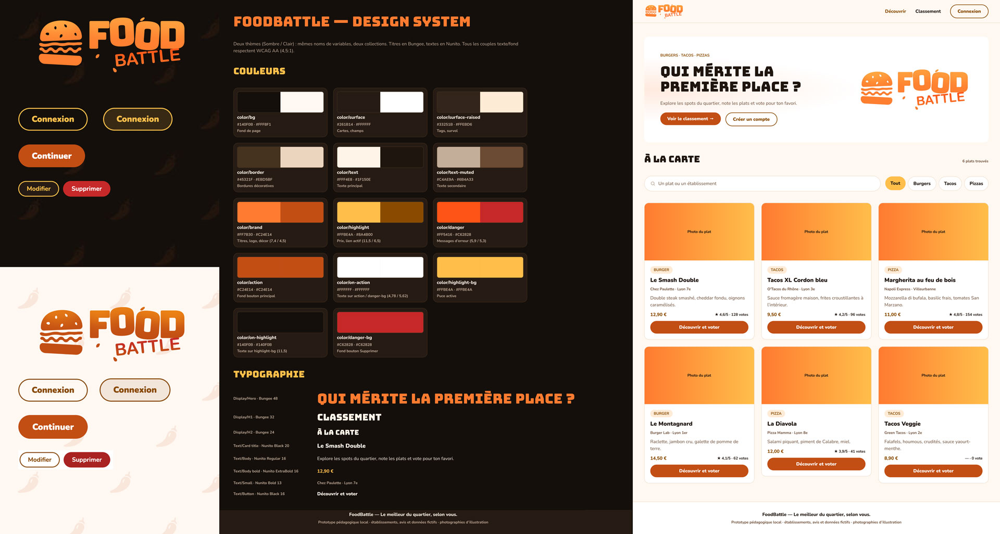

# Design system

Source : maquette Figma « FoodBattle — Design system » (page Fondations), [lien](https://www.figma.com/design/vKmUDbfqhsOdcx5HXXaDwa).
Dans le code, chaque valeur est une **variable CSS** : `tokens.css` (commun aux deux thèmes),
`theme-dark.css` (thème par défaut) et `theme-light.css`. Si l'un change, on met l'autre à jour.

## 1. Intention

**Public visé** : un public jeune, mais pas trop, qui sort, partage ses bonnes adresses et accepte de payer
pour un bon plat. FoodBattle ne met pas en avant les enseignes les moins chères, mais la **street food de qualité**
du quartier : burgers, tacos et pizzas faits avec soin.

**Ambiance** : street food, compétition, convivialité. Une ambiance de **soirée** (thème sombre par défaut), réchauffée par
l'**orange et le jaune** de la braise et du fromage fondu. Les titres en **Bungee**, une police d'enseigne et
d'arcade, donnent le ton « battle » ; le texte en **Nunito**, arrondie, reste douce et lisible.
Le piment en motif de fond rappelle le thème sans prendre le pas sur les photos des plats, qui portent
l'envie : un rendu soigné, loin des codes « prix cassés » de la restauration rapide.

## 2. Typographie

| Rôle | Police | Taille | Graisse |
|---|---|---|---|
| Titre du bandeau d'accueil | Bungee | 48 px (`--font-size-hero`) | 400 |
| Titre de page | Bungee | 32 px (`--font-size-h1`) | 400 |
| Sous-titre | Bungee | 24 px (`--font-size-h2`) | 400 |
| Nom d'un plat | Nunito | 20 px (`--font-size-card-title`) | 900 |
| Texte courant, boutons | Nunito | 16 px (`--font-size-body`) | 400 à 900 |
| Établissement, note, tag | Nunito | 13 px (`--font-size-small`) | 700 |

- Tailles en `rem` : le texte suit la taille choisie par l'utilisateur dans son navigateur.
- Bungee n'existe qu'en une graisse : jamais de faux gras (le navigateur le déformerait).
- Polices hébergées sur le site (pas de Google Fonts) : rien n'est chargé chez un tiers.

## 3. Couleurs

| Rôle | Variable | Sombre | Clair |
|---|---|---|---|
| Fond de page | `--color-bg` | `#140f0b` | `#fff8f1` |
| Cartes, surfaces | `--color-surface` | `#261b14` | `#ffffff` |
| Tags, survol | `--color-surface-raised` | `#33251b` | `#ffebd6` |
| Bordures | `--color-border` | `#45321f` | `#ebd5bf` |
| Texte | `--color-text` | `#fff4e8` | `#1f150e` |
| Texte secondaire | `--color-text-muted` | `#c4ae9a` | `#6b4a33` |
| Marque (logo, décor) | `--color-brand` | `#ff7b30` | `#c24e14` |
| Prix, lien actif, bouton secondaire | `--color-highlight` | `#ffbe4a` | `#8a4b00` |
| Pastille active (fond / texte) | `--color-highlight-bg` / `--color-on-highlight` | `#ffbe4a` / `#140f0b` | idem |
| Bouton principal (fond / texte) | `--color-action` / `--color-on-action` | `#c24e14` / `#ffffff` | idem |
| Erreur (texte) | `--color-danger` | `#ff5416` | `#c62828` |
| Supprimer (fond) | `--color-danger-bg` | `#c62828` | idem |

Couleurs **calculées** plutôt qu'inventées, pour rester dans la palette dans les deux thèmes :
fond de succès, papier peint, lueur du bandeau, fond des champs (`color-mix()`).

### Contrastes (WCAG 2.2 AA : 4,5:1 minimum pour le texte)

| Texte sur fond | Sombre | Clair |
|---|---|---|
| Texte / fond de page | 17,6:1 | 17,0:1 |
| Texte secondaire / carte | 7,9:1 | 7,9:1 |
| Prix, liens / carte | 10,2:1 | 6,8:1 |
| Bouton principal | 4,8:1 | 4,8:1 |
| Erreur / carte | 5,2:1 | 5,6:1 |

Le jaune et l'orange sont **plus foncés en thème clair** (`#8a4b00`, `#c24e14`) : les teintes vives du thème sombre
seraient illisibles sur du blanc.

## 4. Espacements, arrondis, ombres

| Espacements | `--space-xs` 4 · `sm` 8 · `md` 16 · `lg` 24 · `xl` 40 · `2xl` 56 px |
|---|---|
| **Arrondis** | Champs 10 px · cartes et bandeau 16 px · boutons et tags en pilule |
| **Ombre** | Noire et légère en sombre (la lueur suffit), teintée d'orange en clair |
| **Largeur max.** | 1200 px ; passage en mobile à 700 px |

Règle de forme : **la pilule est réservée à ce qui se clique** (boutons, tags, pastilles de filtre) ;
les champs de saisie sont des rectangles arrondis.

## 5. Composants

| Composant | Variantes |
|---|---|
| Bouton | Principal (orange) · secondaire (contour jaune) · danger · petit (tableaux) · pleine largeur |
| Champs | Texte, recherche avec loupe, mot de passe avec œil, liste déroulante avec flèche maison |
| Carte de plat | Photo, tag de catégorie, nom, établissement, prix, note |
| Tableau | Classique sur ordinateur, **en cartes** sur mobile (chaque cellule garde son libellé) |
| Pastilles | Navigation admin, filtre de modération, filtre de la roue, tri du dashboard sur mobile |
| Messages | Confirmation, erreur (annoncés aux lecteurs d'écran) |
| Bloc repliable | « Ajouter un plat », avec chevron maison |
| Roue du destin | 6 parts en deux tons de jaune, jante et pointeur orange |

## 6. Accessibilité intégrée au design system

- Contrastes AA dans les deux thèmes (§ 3).
- Focus clavier visible partout : contour jaune de 2 px.
- Zones cliquables d'au moins 44 px de haut pour les boutons.
- Mouvement réduit respecté (la roue ne tourne pas).
- Icônes décoratives masquées aux lecteurs d'écran ; jamais d'information portée par la couleur seule.
